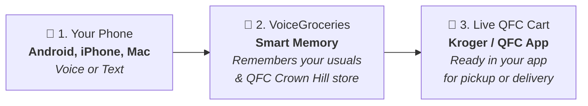
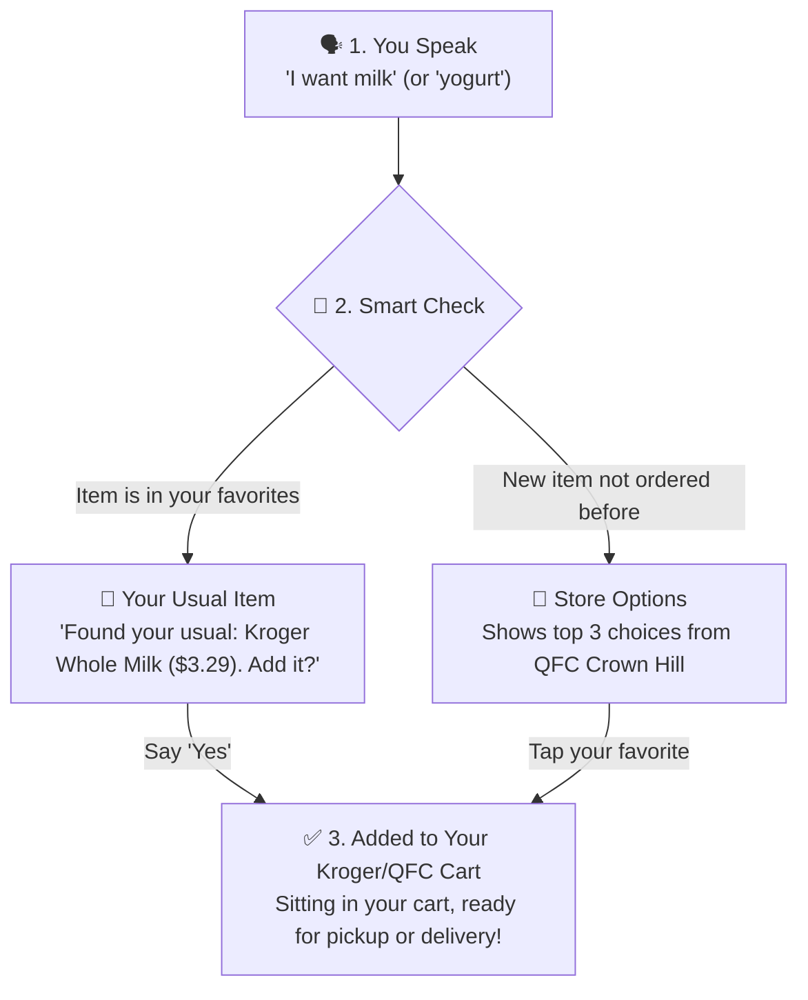
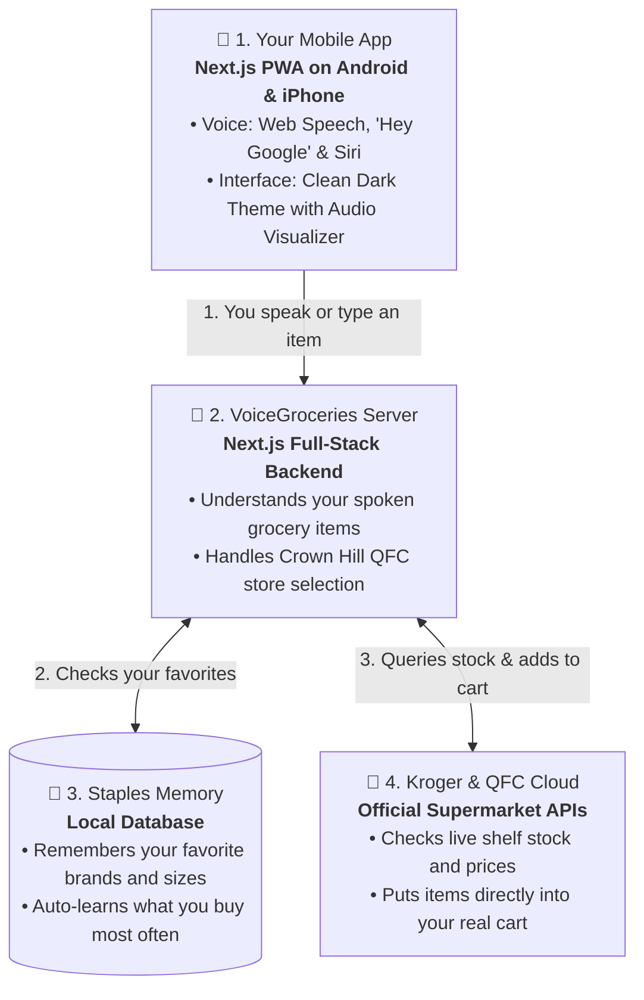

# VoiceGroceries 🛒🎙️

> Voice-enabled grocery assistant with smart staples memory and live Kroger & QFC cart integration. Works hands-free on **Android** (*"Hey Google"*) and **Apple iPhone** (*"Hey Siri"*).

---

## 1. High-Level Concept



---

## 2. How the Voice Ordering Flow Works



---

## 3. System Architecture & Technologies



---

## 4. Technology Stack Matrix

| Layer | Technology | What It Does |
| :--- | :--- | :--- |
| **Mobile Client** | **Next.js 16 (PWA)** | 1-tap install on Android & iPhone, runs full-screen with app icon |
| **Voice Speech-to-Text** | **HTML5 Web Speech API** | Converts your spoken voice (*"I want milk"*) into real-time text in the browser |
| **Voice Audio Feedback** | **SpeechSynthesis API** | Speaks conversational confirmations (*"Found your usual Kroger milk..."*) |
| **Hands-Free Wake Words** | **Google Assistant & Siri** | Trigger via *"Hey Google"* (Android) and *"Hey Siri"* (iOS) |
| **UI Styling** | **Pure Vanilla CSS** | Tailored dark theme, glassmorphic cards, soundwave animations |
| **Backend Server** | **Next.js App Router (Node.js 20+)** | Full-stack API routes, intent parser, Kroger API client |
| **Staples Memory** | **JSON / SQLite (Prisma)** | Auto-remembers favorite brands, sizes, and order frequency |
| **Grocery APIs** | **Kroger Developer API** | Live catalog search, QFC Crown Hill stock, Customer Cart additions |
| **Testing & CI** | **Vitest + GitHub Actions** | 11 automated unit tests and CI build verification on every push |

---

## 5. Core Features

* **"Order My Usual" Staples Intelligence**: Solves Kroger's missing purchase-history API by remembering your household staples and auto-learning what you buy most frequently.
* **Live Catalog Search with Options**: Searching for new items (like *"yogurt"*) queries Kroger's live production catalog and displays top options with photos, sizes, and prices.
* **50-Mile Store Locator**: Set your home store to **QFC Crown Hill (`70500872`)** or search any store across 50 miles via GPS or Zip code.
* **Universal Assistant Webhook**: Connects to Google Assistant Routines and Apple Siri Shortcuts for true hands-free voice access.
* **Zero Credential Leaks**: Strict `.gitignore` rules prevent private API secrets or database files from ever being committed.

---

## 6. Getting Started

### 1. Clone the Repository
```bash
git clone https://github.com/ggrossvi/voice-grocery.git
cd voice-grocery
npm install
```

### 2. Configure Environment Variables
Copy `.env.example` to `.env`:
```bash
cp .env.example .env
```
Fill in your Kroger Developer credentials from [developer.kroger.com](https://developer.kroger.com):
```env
KROGER_CLIENT_ID=your_client_id_here
KROGER_CLIENT_SECRET=your_client_secret_here
KROGER_DEFAULT_LOCATION_ID=70500872
```

### 3. Verify Kroger Credentials (Privately)
Test that your Kroger Client ID and Secret are working against live Kroger production servers without exposing keys:
```bash
node --env-file=.env scripts/test-kroger.mjs
```

### 4. Start Development Server
```bash
npm run dev
```
* **Laptop**: Open [http://localhost:3000](http://localhost:3000)
* **Mobile Phone**: Open `http://YOUR_LOCAL_IP:3000` in Chrome (Android) or Safari (iOS).

### 5. Run Automated Unit Tests
```bash
npm test
```
Runs the full Vitest suite covering voice intent parsing, staples memory, Crown Hill store matching, and Kroger data normalization.

---

## 7. Architecture & Security Documentation

* **[DECISIONS.md](./DECISIONS.md)**: Architecture Decision Records (ADRs) explaining the rationale behind PWA choice, staples memory, and dual-tier OAuth.
* **[SECURITY.md](./SECURITY.md)**: Security policy covering credential protection, token storage in HTTP-only cookies, and browser security contexts.
